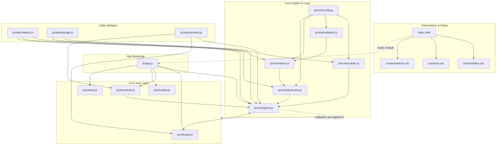
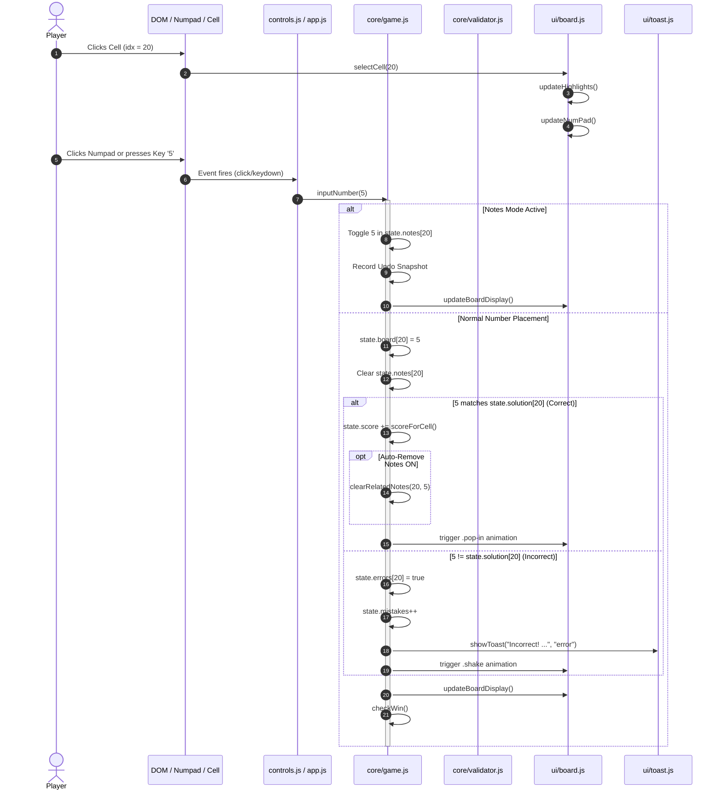

# Super Sudoku — Comprehensive Technical Project Documentation

> **File:** `PROJECT_CONTEXT.md`  
> **Target Audience:** AI Coding Assistants, Senior Software Engineers, Code Reviewers  
> **Status:** Grounded against the verified codebase implementation  
> **Last Updated:** October 2026  

---

## Table of Contents
1. [A. Project Overview](#a-project-overview)
2. [B. Technology Stack](#b-technology-stack)
3. [C. Complete Folder Structure](#c-complete-folder-structure)
4. [D. Architecture and Module Responsibilities](#d-architecture-and-module-responsibilities)
5. [E. Detailed Module Documentation](#e-detailed-module-documentation)
6. [F. Sudoku Logic and Algorithms](#f-sudoku-logic-and-algorithms)
7. [G. User Interface and User Experience](#g-user-interface-and-user-experience)
8. [H. State Management and Data Flow](#h-state-management-and-data-flow)
9. [I. Persistence and Storage](#i-persistence-and-storage)
10. [J. HTML, CSS, and Visual Design](#j-html-css-and-visual-design)
11. [K. User Interaction and Event Flow](#k-user-interaction-and-event-flow)
12. [L. Current Implementation Status](#l-current-implementation-status)
13. [M. Bugs, Risks, and Technical Debt](#m-bugs-risks-and-technical-debt)
14. [N. Dependencies and Execution Instructions](#n-dependencies-and-execution-instructions)
15. [O. Extension Guide for Future AI Coding](#o-extension-guide-for-future-ai-coding)
16. [P. File-by-File Reference](#p-file-by-file-reference)
17. [Q. Instructions for Future AI Assistants](#q-instructions-for-future-ai-assistants)

---

## A. Project Overview

### Purpose
**Super Sudoku** (branded as **Sudoku Master**) is a client-side, zero-dependency, browser-based Sudoku application engineered with modern ES Modules and a dark, futuristic neon aesthetic. Its primary purpose is to provide an accessible, responsive, and scalable puzzle-solving experience supporting traditional $9 \times 9$ gameplay as well as miniature ($4 \times 4$) and large-scale hexadecimal/alphanumeric grids ($16 \times 16$ and $25 \times 25$).

### Target Users
- Casual puzzle players seeking a visually polished, distraction-free interface.
- Advanced Sudoku enthusiasts tackling large-grid puzzles ($16 \times 16$, $25 \times 25$).
- Desktop and mobile users requiring responsive touch and keyboard navigation.

### Current Implemented Features
- **Dynamic Board Scaling**: Supports $4 \times 4$, $9 \times 9$, $16 \times 16$, and $25 \times 25$ grids through a unified geometry engine and CSS variable system.
- **Difficulty Settings**: 4 tiers (Easy, Medium, Hard, Expert) with tuned clue ratios per grid size.
- **Solving Engine**: Backtracking solver utilizing standard search for $\le 9 \times 9$ and Minimum Remaining Values (MRV) heuristic for $> 9 \times 9$.
- **Puzzle Generator**: Generates valid solvable puzzles. Small boards ($\le 9 \times 9$) guarantee unique solutions; large boards ($> 9 \times 9$) employ diagonal box seeding, deterministic solving, symbol permutation, and row/column band shuffling.
- **Assisted Input & Notes**: Notes/pencil marks mode, automatic note cleanup in row/col/box upon cell fill, duplicate number highlighting, and related cell highlighting.
- **Mistake Tracking**: Configurable error highlighting, mistake counter with game-over threshold (3 mistakes), and animated error shaking.
- **Action Suite**: Multi-step move Undo, smart Hints (auto-fills empty or selected cell from solution), Auto-Solve, Board Reset, and Solution Reveal on game over.
- **Analytics & Progression**: Live game timer, dynamic score calculation with time-decay bonus, accuracy progress bar, and completion percentage.
- **Paginated Keypad**: For board sizes with $> 9$ symbols, a paginated number pad maintains fixed touch-target dimensions with page arrows and dot indicators.
- **Full Keyboard Navigation**: Arrow-key grid navigation, alphanumeric key entry ($1\text{–}9$, $A\text{–}P$), $N$ for notes, $Z$/$Ctrl+Z$ for undo, $H$ for hint, $Del$/$Backspace$/$0$ for erase.
- **Victory & Defeat Modals**: Win modal with stat breakdown and HTML5 canvas confetti; lose modal with retry or solution reveal.
- **Responsive Layout**: Specialized mobile viewport stacking placing the Sudoku grid and keypad above settings/action panels.
- **Best Times Persistence**: High-score completion records stored via `localStorage`.

### Incomplete, Planned, or Missing Features
- **Active Game State Persistence**: Refreshing the browser terminates the current game; neither board state, timer, nor move history are saved to storage.
- **Per-Size Best Times**: Best-time records in `localStorage` share keys across board sizes without size partitioning (e.g., $4 \times 4$ Easy overwrites $9 \times 9$ Easy).
- **Candidate Elimination Helper**: No auto-candidate generator to fill all possible pencil marks automatically.
- **Web Worker Background Generation**: Generation of $25 \times 25$ puzzles runs on the main UI thread during a 50ms timeout, which may drop frames on low-end mobile hardware.
- **Multiplayer / Seed Sharing**: No puzzle seed export/import or URL state sharing.

### Application Entry Point and Execution Flow
1. **Entry Point**: [index.html](file:///C:/Users/VICTUS/OneDrive/Desktop/CZ/Super%20Sudoku/index.html).
2. **Module Bootstrap**: Loads `<script type="module" src="js/app.js"></script>`.
3. **Execution Flow** ([app.js](file:///C:/Users/VICTUS/OneDrive/Desktop/CZ/Super%20Sudoku/js/app.js)):
   - Imports core modules (`game.js`, `board.js`, `controls.js`, `modal.js`, `toast.js`).
   - Wires UI functions into game logic via `registerUI()`.
   - Initialises particle background (`initBg()`).
   - Registers global keyboard listener (`initKeyboard()`).
   - Binds click delegation for all `data-action` elements (`initActionButtons()`).
   - Loads and renders best times from `localStorage` (`updateBestTimes()`).
   - Calls `newGame()`, generating the initial $9 \times 9$ Medium puzzle and mounting the board.

---

## B. Technology Stack

### Languages & Standards
- **HTML5**: Semantic tags (`<header>`, `<main>`, `<canvas>`, role attributes `grid`, `gridcell`, `progressbar`, `switch`).
- **CSS3**: Vanilla CSS with CSS custom properties (design tokens in `variables.css`), CSS Grid (`repeat(N, 1fr)`), Flexbox, CSS transitions, and `@keyframes` animations. Zero CSS frameworks (no Tailwind, Bootstrap, etc.).
- **JavaScript**: Modern ECMAScript (ES2022+ / ES Modules) using native `import` and `export`. Zero transpilation, bundling, or Babel steps.

### Module System
- Native browser ES Modules (`type="module"` in `index.html`).
- Relative import paths (e.g., `'./core/game.js'`).
- Note: Requires serving over HTTP/HTTPS due to browser CORS security policies restricting module imports via `file://`.

### Third-Party Libraries & Dependencies
- **External Dependencies**: **0** (No npm packages, no CDN scripts, no external fonts or icons).
- **Graphics/Animations**: Pure custom HTML5 Canvas 2D particle engine for victory confetti; pure DOM elements for background ambient floating particles.

### Browser APIs Utilized
- **DOM & Web APIs**: `document.querySelector`, `addEventListener`, `requestAnimationFrame`, `setInterval`, `clearInterval`, `setTimeout`.
- **Canvas 2D Context API**: `HTMLCanvasElement.getContext('2d')` for confetti simulation.
- **Web Storage API**: `window.localStorage` for best completion times.
- **Accessibility (ARIA)**: Dynamic updates to `aria-label`, `aria-pressed`, `aria-checked`, `aria-readonly`, `aria-rowcount`, `aria-colcount`.

### Development Server & Build Tooling
- **Build System**: None (no Webpack, Vite, Rollup, or esbuild).
- **Development Server**: Any static HTTP server (e.g., Python `python -m http.server 8080`, Node `npx serve .`, or IDE Live Server).

---

## C. Complete Folder Structure

```text
Super Sudoku/
│
├── .git/                       ← Git version control metadata
├── .gitignore                  ← Ignores node_modules, dist, build, IDE files, logs
├── README.md                   ← Project summary, feature overview, and run instructions
├── PROJECT_CONTEXT.md          ← [This Document] Definitive AI technical specification
├── index.html                  ← Primary application HTML entry point
├── sudoku.html                 ← Legacy monolithic single-file prototype (unreferenced)
│
├── css/
│   ├── variables.css           ← Root design tokens (colors, cell backgrounds, borders, shadows)
│   ├── style.css               ← Main layout, panels, grid sizing, numpad, modals, responsive CSS
│   └── animations.css          ← Keyframe definitions and animation utility classes
│
└── js/
    ├── app.js                  ← Application bootstrap, dependency injection, and event delegation
    │
    ├── core/
    │   ├── config.js           ← Geometry definitions (4x4, 9x9, 16x16, 25x25), clue tuning, active config
    │   ├── game.js             ← Game logic, lifecycle, timer, score, input processing, undo, hints
    │   ├── generator.js        ← Puzzle generation, diagonal box seeding, permutations, cell removal
    │   ├── solver.js           ← Backtracking solver with MRV heuristic and solution counter
    │   ├── sudoku.js           ← Central state container object and difficulty config accessor
    │   └── validator.js        ← Pure Sudoku constraint validation (row, column, subgrid)
    │
    ├── ui/
    │   ├── board.js            ← Board DOM creation, cell rendering, highlights, stats, progress
    │   ├── controls.js         ← Keypad rendering, pagination (for >9 symbols), keyboard routing, bg particles
    │   ├── modal.js            ← Dialog display and dismissal helpers (win/lose modals)
    │   └── toast.js            ← Toast alerts and HTML5 canvas confetti
    │
    └── utils/
        ├── helpers.js          ← Fisher-Yates shuffle array utility and m:ss time formatting
        ├── storage.js          ← Resilient JSON parsing and localStorage wrapper for best times
        └── symbols.js          ← Bi-directional conversion between numeric values (1-25) and glyphs (1-9, A-P)
```

---

## D. Architecture and Module Responsibilities

The architecture follows a decoupled **Model-View-Controller / Module-Driven** structure. The core engine is separated into pure algorithmic components, a central shared state store, dynamic UI presenters, and an orchestrator.

### Layer Responsibilities
1. **State & Configuration Layer (`core/config.js`, `core/sudoku.js`)**:
   - `config.js` maintains the active board geometry (board size, box rows/cols, clue requirements, cell typography tokens).
   - `sudoku.js` exports a mutable `state` object holding the active board matrix, solution, notes, errors, selection, and options.
2. **Logic & Computational Layer (`core/validator.js`, `core/solver.js`, `core/generator.js`)**:
   - Pure algorithmic functions that take board arrays and configuration values without reading or writing DOM elements.
3. **Application & Lifecycle Layer (`core/game.js`)**:
   - Coordinates user inputs, checks wins/losses, tracks scores and mistakes, controls timers, and records history logs.
   - UI functions are supplied via dependency injection (`registerUI()`) to avoid circular imports.
4. **Presentation Layer (`ui/board.js`, `ui/controls.js`, `ui/modal.js`, `ui/toast.js`)**:
   - Builds and updates DOM elements, manages CSS classes for visual states, renders the keypad with pagination, displays modals, toasts, and canvas animations.
5. **Bootstrap & Integration Layer (`app.js`)**:
   - Wires UI callbacks into `game.js`, attaches document-wide event delegation for clicks and keystrokes, and initializes the first game.

### Architecture Diagram (Mermaid)



---

## E. Detailed Module Documentation

### 1. `js/core/config.js`
- **Purpose**: Defines geometries, clue requirements, styling tokens, and runtime constants for all supported board sizes.
- **Exported Constants & Objects**:
  - `BOARD_SIZES`: Immutable frozen registry of supported configurations:
    - `4`: `boardSize: 4`, `boxRows: 2`, `boxCols: 2`, `maxHints: 2`, clues: 12 (Easy), 10 (Med), 8 (Hard), 6 (Exp).
    - `9`: `boardSize: 9`, `boxRows: 3`, `boxCols: 3`, `maxHints: 3`, clues: 45 (Easy), 35 (Med), 28 (Hard), 22 (Exp).
    - `16`: `boardSize: 16`, `boxRows: 4`, `boxCols: 4`, `maxHints: 5`, clues: 160 (Easy), 130 (Med), 100 (Hard), 80 (Exp).
    - `25`: `boardSize: 25`, `boxRows: 5`, `boxCols: 5`, `maxHints: 7`, clues: 390 (Easy), 315 (Med), 245 (Hard), 195 (Exp).
  - `BOARD_CONFIG`: Mutable active configuration singleton. Evaluates `cellCount` ($N^2$) and `symbols` ($[1 \dots N]$) dynamically via getters.
- **Functions**:
  - `setBoardSize(size: 4|9|16|25): void`: Updates `BOARD_CONFIG` properties in place to match `BOARD_SIZES[size]`. Throws error if size is unregistered.
  - Legacy Callers: `BOARD_SIZE()`, `BOX_ROWS()`, `BOX_COLS()`, `CELL_COUNT()`, `SYMBOLS()`.

### 2. `js/core/sudoku.js`
- **Purpose**: Central state module holding the runtime game status.
- **Exported Symbols**:
  - `DIFF_CONFIG()`: Function returning `BOARD_CONFIG.difficulty` for the active board size.
  - `state`: Global state object with properties:
    - `board`: `number[]` — 1D array of length $N^2$ storing cell values ($0 = \text{empty}$).
    - `solution`: `number[]` — Complete solved board solution.
    - `given`: `boolean[]` — Flags indicating whether cell was provided at game start.
    - `notes`: `Set<number>[]` — Array of Sets containing player pencil marks.
    - `errors`: `boolean[]` — Flags indicating incorrect player entries.
    - `selected`: `number` — 0-based cell index of active selection ($-1$ if none).
    - `difficulty`: `'easy' | 'medium' | 'hard' | 'expert'`.
    - `mistakes`: `number` — Count of incorrect entries made.
    - `maxMistakes`: `number` — Maximum allowed mistakes before loss (defaults to 3).
    - `score`: `number` — Current player score.
    - `hintsLeft`, `hintsUsed`: `number`.
    - `timerSec`, `timerActive`, `timerRef`: Timer interval tracking state.
    - `history`: `Array<{ idx, oldVal, newVal, oldNotes, isNote }>` — Undo stack.
    - `opts`: `{ related: boolean, samenum: boolean, mistakes: boolean, notes: boolean, autonotes: boolean }`.
    - `bestTimes`: `Record<string, number>` — Object mapping difficulty to fastest seconds.
    - `gameActive`: `boolean` — Whether game is accepting moves.
    - `selectedNum`: `number` — Currently highlighted number on numpad/board.
    - `boardSizeKey`: `number` — Active size integer ($4, 9, 16, 25$).

### 3. `js/core/validator.js`
- **Purpose**: Pure Sudoku constraint validation.
- **Exported Functions**:
  - `isValid(board: number[], idx: number, num: number): boolean`: Checks if placing `num` at 1D index `idx` is valid according to row, column, and sub-box uniqueness constraints. Reads dimensions from `BOARD_CONFIG`. Runs in $O(N)$ iterations where $N = \text{boardSize}$.

### 4. `js/core/solver.js`
- **Purpose**: Backtracking puzzle solver and solution uniqueness counter.
- **Internal Helper**:
  - `_findMRVCell(board: number[]): number`: Minimum Remaining Values heuristic. Scans empty cells, counts valid candidates via `isValid()`, and selects the cell with fewest possibilities. Returns $-2$ immediately on dead-ends (0 candidates), enabling rapid backtracking.
- **Exported Functions**:
  - `solve(board: number[], randomize = false): boolean`: Solves the input board in place using depth-first backtracking. If `boardSize > 9`, uses `_findMRVCell()`; otherwise scans left-to-right (`board.indexOf(0)`). Shuffles candidate symbols if `randomize === true`.
  - `countSolutions(board: number[], limit = 2): number`: Recursively counts valid solutions up to `limit`. Returns 1 for unique puzzles or $\ge 2$ for non-unique.

### 5. `js/core/generator.js`
- **Purpose**: Generates puzzles with tuned clue counts.
- **Internal Helpers**:
  - `_seedDiagonalBoxes(board: number[]): void`: Fills diagonal subgrids with shuffled permutations of symbols $[1 \dots N]$. Because diagonal boxes do not share rows or columns, they are mutually conflict-free.
  - `_permuteSymbols(board: number[]): void`: Renumbers all symbols according to a random permutation.
  - `_permuteBandsAndStacks(board: number[]): void`: Shuffles rows within horizontal bands and columns within vertical stacks, preserving Sudoku validity.
- **Exported Functions**:
  - `generatePuzzle(clueCount: number): { puzzle: number[], solution: number[] }`:
    - For $\le 9 \times 9$: Solves from an empty grid with randomized branches, then removes cells sequentially, confirming `countSolutions(test, 2) === 1` before removal.
    - For $> 9 \times 9$: Seeds diagonal boxes, solves deterministically, applies symbol and band permutations, and removes cells without uniqueness checks to avoid browser freeze.

### 6. `js/core/game.js`
- **Purpose**: Central state orchestrator and game action handlers.
- **Exported Functions**:
  - `registerUI(ui: object): void`: Receives UI function hooks (`renderBoard`, `showToast`, etc.) to break circular module dependencies.
  - `scoreForCell(): number`: Computes score based on difficulty base ($10, 20, 35, 50$) plus a time bonus ($\max(0, 300 - \text{timerSec}) / 10$).
  - `clearRelatedNotes(idx: number, num: number): void`: Removes `num` from notes of all cells in the same row, column, and subgrid.
  - `startTimer()`, `stopTimer()`: Controls the 1-second interval ticking `state.timerSec`.
  - `checkWin()`: Compares `state.board` with `state.solution`. On completion, saves best times, stops timer, applies `.pulse-win` to board wrapper, triggers `win-modal`, and launches confetti.
  - `inputNumber(num: number)`: Places number or toggles note in `state.selected`. If value is incorrect and `opts.mistakes` is true, increments mistake count, shakes cell, and shows toast; if mistakes reach threshold, opens `lose-modal`.
  - `clearCell()`: Erases current cell value and notes, pushing change to undo stack.
  - `undoMove()`: Reverts the last state snapshot from `state.history`.
  - `useHint()`: Fills a random or selected empty cell directly with the correct solution value, marking it as given. Decrements available hints.
  - `solvePuzzle()`: Prompts confirmation, then auto-fills all non-given cells from `state.solution`.
  - `revealSolution()`: Closes lose modal and auto-fills board.
  - `newGame()`: Resets all counters, generates a fresh puzzle, resets timer, and updates board and numpad.
  - `setDifficulty(d: string)`: Updates difficulty string, switches button active state, and initiates `newGame()`.
  - `setBoardSizeAndNewGame(size: number)`: Calls `setBoardSize(size)`, updates ARIA board attributes and keyboard shortcut label, and initiates `newGame()`.
  - `confirmReset()`: Erases all non-given cell entries, clears mistakes, and resets history without generating a new puzzle.
  - `toggleOpt(key: string)`: Inverts boolean flag in `state.opts`, syncs switch UI, and updates board display.

### 7. `js/ui/board.js`
- **Purpose**: DOM generation, cell rendering, highlights, and sidebar visual updates.
- **Exported Functions**:
  - `renderBoard()`: Reconstructs the grid container (`#sudoku-board`), sets inline CSS variables (`--cell-font-size`, `--note-font-size`, `--completion-dot-size`, etc.), and creates each `.cell` element with completion rings, note sub-grids, values, and box borders.
  - `updateBoardDisplay()`: Iterates all cells, showing/hiding values or note grids, toggling error states, and updating accessibility labels.
  - `updateHighlights()`: Adds `.selected`, `.related`, and `.same-num` classes based on `state.selected` and active toggle options.
  - `selectCell(idx: number)`: Toggles cell selection, syncing `state.selected` and `state.selectedNum`.
  - `updateStats()`: Updates timer, mistakes, score, and filled counts.
  - `updateProgress()`: Recomputes accuracy, fill percentage, and hint bars.
  - `updateBestTimes()`: Renders best times list from `state.bestTimes`.

### 8. `js/ui/controls.js`
- **Purpose**: Number pad rendering, pagination controls, keyboard shortcuts, and background animation.
- **Exported Functions**:
  - `renderNumPad()`: Builds keypad buttons for the current page (up to 9 items per page). For large boards, prepends ◀ and appends ▶ navigation arrows.
  - `updateNumPad()`: Updates remaining counts per number, toggles `.exhausted` and `.selected-num` classes, and disables pagination arrows when at bounds.
  - `initKeyboard()`: Binds `document.addEventListener('keydown')` to map arrow keys, digits, alphanumeric letters ($A\text{–}P$), $N$, $Z$, $H$, and $Delete$.
  - `initBg()`: Generates 40 animated floating particle `<span>` elements inside `#bg-anim`.

### 9. `js/ui/modal.js`
- **Purpose**: Simple modal presentation helper.
- **Exported Functions**:
  - `showModal(id: string)`: Adds `.show` class to modal overlay.
  - `closeModal(id: string)`: Removes `.show` class from modal overlay.

### 10. `js/ui/toast.js`
- **Purpose**: Toast banners and canvas victory confetti.
- **Exported Functions**:
  - `showToast(msg: string, type: string, dur = 2500)`: Mounts a temporary banner into `#toast-container` with slide-in and slide-out transitions.
  - `launchConfetti()`: Spawns 150 physics-driven rotating confetti particles on `#confetti-canvas` using `requestAnimationFrame`.

### 11. `js/utils/helpers.js`
- **Purpose**: Math and formatting utilities.
- **Exported Functions**:
  - `shuffle(arr: any[]): any[]`: In-place Fisher-Yates array shuffle.
  - `formatTime(s: number): string`: Converts seconds into `m:ss` display format.

### 12. `js/utils/storage.js`
- **Purpose**: Safe localStorage read/write with error resilience.
- **Exported Functions**:
  - `loadBestTimes(): Record<string, number>`: Loads `'sudoku_best'` key using `safeParseJSON()`. If corrupted, deletes key and returns empty object `{}`.
  - `saveBestTimes(bestTimes: object): void`: Serializes and writes best times object to `localStorage`.

### 13. `js/utils/symbols.js`
- **Purpose**: Bi-directional value-to-glyph conversion. Zero dependencies.
- **Exported Functions**:
  - `toSymbol(n: number): string`: Converts integer $1\text{–}9 \to '1'\text{–}'9'$, $10 \to 'A'$, $11 \to 'B'$, $\dots$, $25 \to 'P'$.
  - `fromSymbol(s: string): number`: Inverts symbol character to numeric value ($'A' \to 10$, etc.).
  - `keyToNum(key: string, boardSize: number): number | null`: Validates whether a pressed key string maps to a valid symbol for the active board size.

---

## F. Sudoku Logic and Algorithms

### Board Representation
- **Linear 1D Array**: A board of size $N$ is stored as a flat array of length $N^2$ (e.g., 81 cells for $9 \times 9$, 625 cells for $25 \times 25$).
- **Coordinate Mapping**:
  $$\text{row} = \lfloor \text{idx} / N \rfloor, \quad \text{col} = \text{idx} \pmod N$$
  $$\text{idx} = \text{row} \times N + \text{col}$$
- **Subgrid (Box) Mapping**:
  For box dimensions $R_{\text{box}}$ (rows) and $C_{\text{box}}$ (cols):
  $$\text{boxRowStart} = \lfloor \text{row} / R_{\text{box}} \rfloor \times R_{\text{box}}, \quad \text{boxColStart} = \lfloor \text{col} / C_{\text{box}} \rfloor \times C_{\text{box}}$$

### Constraint Validation (`isValid`)
```text
Algorithm isValid(board, idx, num):
  row = floor(idx / boardSize)
  col = idx % boardSize
  boxR = floor(row / boxRows) * boxRows
  boxC = floor(col / boxCols) * boxCols

  for i from 0 to boardSize - 1:
    if board[row * boardSize + i] == num: return false
    if board[i * boardSize + col] == num: return false
    boxCell = (boxR + floor(i / boxCols)) * boardSize + (boxC + (i % boxCols))
    if board[boxCell] == num: return false

  return true
```

### Solving Algorithm (`solve`)
Depth-first search with backtracking:
1. **Cell Selection**:
   - For $N \le 9$: Selects the first empty cell (`board.indexOf(0)`).
   - For $N > 9$: Calls `_findMRVCell(board)` to find the empty cell with minimum valid candidates. If any empty cell has 0 candidates, returns `false` immediately (dead-end pruning).
2. **Candidate Search**:
   - Shuffles symbol array if `randomize === true` (used in generation).
   - For each candidate $n \in [1 \dots N]$:
     - If `isValid(board, idx, n)` is `true`:
       - Sets `board[idx] = n`.
       - Recursively calls `solve(board, randomize)`. If `true`, returns `true`.
       - Backtracks: `board[idx] = 0`.
3. Returns `false` if all candidates fail.

### Puzzle Generation Algorithm (`generatePuzzle`)
```text
Algorithm generatePuzzle(clueCount):
  sol = new Array(cellCount).fill(0)

  if boardSize > 9:
    _seedDiagonalBoxes(sol)
    solve(sol, randomize=false) // Deterministic, fast
    _permuteSymbols(sol)
    _permuteBandsAndStacks(sol)
  else:
    solve(sol, randomize=true)  // Random solve from empty

  puzzle = copy(sol)
  positions = shuffle([0 ... cellCount - 1])
  removed = 0
  target = cellCount - clueCount

  for pos in positions:
    if removed >= target: break
    backup = puzzle[pos]
    puzzle[pos] = 0

    if boardSize <= 9:
      if countSolutions(copy(puzzle), limit=2) != 1:
        puzzle[pos] = backup
        continue

    removed++

  return { puzzle, solution: sol }
```

### Algorithmic Limitations & Performance Considerations
- **$25 \times 25$ Generation Cost**: Solving a $25 \times 25$ board involves a search space of 625 cells. While diagonal seeding constrains the search dramatically, execution on the main UI thread can take 100ms–300ms depending on CPU speed, causing a minor frame stutter during `newGame()`.
- **Heuristic Uniqueness on Large Grids**: $16 \times 16$ and $25 \times 25$ puzzles omit the `countSolutions(..., 2)` check because checking uniqueness for 100+ removed cells on large grids would result in exponential timeouts. While clue counts remain sufficiently high to provide unique or near-unique solutions, absolute mathematical uniqueness is not verified.

---

## G. User Interface and User Experience

### Layout & Visual Hierarchy
- **Desktop Layout (`> 900px`)**: Three-column horizontal flexbox:
  1. **Left Panel (200px)**: Difficulty selector card, Actions card (New Game, Undo, Hint, Solve, Reset), Options toggles card.
  2. **Center Section**: Header banner, Stats bar (Timer, Mistakes, Score, Filled), Size selector ($4\times4$, $9\times9$, $16\times16$, $25\times25$), Board wrapper, Paginated numpad, Keyboard shortcuts hint.
  3. **Right Panel (200px)**: Progress card (Filled %, Accuracy %, Hints used), Best Times card.
- **Mobile/Phone View (`\le 900px`)**:
  - Uses CSS flexbox `order` to prioritize gameplay:
    - **Order 1**: Board section (Header, Stats chips, Size selector, Grid, Numpad) displayed at the very top.
    - **Order 2**: Left panel (Difficulty, Actions, Options) positioned directly below the keypad.
    - **Order 3**: Right panel (Progress, Best Times) at the bottom.
  - Page wrapper switches to `overflow-y: auto; height: auto; min-height: 100vh;` to allow smooth vertical scrolling.

### Cell Visual States
- `.cell`: Base dark background (`#1e1e32`), 1px border.
- `.cell.given`: Darker background (`#12122a`), brighter text (`#eaeaea`), non-editable.
- `.cell.selected`: Highlighted border and glow (`#0f3460`).
- `.cell.related`: Subtly illuminated background (`#1c1c35`) for shared row/column/box.
- `.cell.same-num`: Distinct purple glow (`#2d2060`) for cells matching the selected number.
- `.cell.error`: Red-tinted background (`#3a1020`) and text (`#e94560`).
- `.cell.complete`: Displays subtle, adaptive green radial gradient originating from top-right corner without overlapping digits.

### Paginated Numpad UX
- Keeps keypad button dimensions identical regardless of grid size:
  $$\text{buttonWidth} = \frac{\min(420\text{px}, 90\text{vw}) - 8 \times 6\text{px}}{9}$$
- For $16 \times 16$: Page 1 ($1\text{–}9$), Page 2 ($A\text{–}G$).
- For $25 \times 25$: Page 1 ($1\text{–}9$), Page 2 ($A\text{–}I$), Page 3 ($J\text{–}P$).
- Nav arrows (◀ ▶) allow instant paging, accompanied by visual dot indicators.

---

## H. State Management and Data Flow

### Source of Truth
The application maintains a single, mutable state object (`state` in `js/core/sudoku.js`). All game actions mutate properties on `state`, followed by explicit presenter updates (`updateBoardDisplay()`, `updateStats()`, `updateNumPad()`).

### User Action Data Flow (Number Placement Sequence)



---

## I. Persistence and Storage

### Storage Mechanism
- Uses browser `window.localStorage`.
- Storage key: `'sudoku_best'`.
- Format: JSON-serialized string representing best times in seconds, keyed by difficulty:
  ```json
  {
    "easy": 142,
    "medium": 320,
    "hard": 580
  }
  ```

### Recovery & Error Handling
- Implemented in `safeParseJSON()` inside `js/utils/storage.js`.
- If `JSON.parse` throws an exception, a `console.warn` is issued, `localStorage.removeItem(key)` purges the corrupted data, and an empty fallback object `{}` is returned.
- Application will not crash if local storage is disabled, restricted, or corrupted.

### Limitations
1. **No Session Survival**: Active board matrices, timer, score, and notes are held in volatile memory. Reloading the page clears the active game.
2. **Key Collisions across Sizes**: Best completion times do not include the board size in their keys, causing a fast $4 \times 4$ win to overwrite a $9 \times 9$ or $25 \times 25$ record of the same difficulty.

---

## J. HTML, CSS, and Visual Design

### DOM Tree Structure (`index.html`)
- `#bg-anim`: Fullscreen container holding animated floating particle spans.
- `#confetti-canvas`: Fullscreen transparent canvas for victory celebration.
- `#toast-container`: Floating container for toast alerts.
- `.modal-overlay#win-modal`: Win celebration dialog with stat chips and action buttons.
- `.modal-overlay#lose-modal`: Game-over dialog with retry and solution reveal buttons.
- `.app-wrapper`: Max-width 440px container optimized for iPhone 16 Pro Max portrait orientation.
  - `<header>`: Logo (no subtitle).
  - `.game-container`:
    - `.stats-bar`: Four compact chips (Timer, Mistakes, Score, Filled).
    - `.size-selector`: Four segmented size buttons (4×4, 9×9, 16×16, 25×25).
    - `.board-wrapper`: `#sudoku-board` (aspect-ratio: 1).
    - `#numpad`: Touch-friendly number keys with pagination controls (`#numpad-dots`).
    - `.panel-card.difficulty-card`: Four horizontal segmented difficulty buttons (Easy, Medium, Hard, Expert).
    - `.panel-card.actions-card`: Two-column action buttons (New Game, Undo, Hint, Auto Solve, Reset).
    - `.panel-card.options-card`: Five option rows with iOS-style toggles.
    - `.panel-card.progress-card`: Filled, Accuracy, Hints Used progress bars.
    - `.panel-card.best-times-card`: Best completion records per difficulty.

### Design Tokens (`css/variables.css`)
- **Backgrounds**: `--bg-dark: #0f0f1a`, `--bg-card: #1a1a2e`, `--bg-panel: #16213e`.
- **Accents**: `--accent: #e94560` (crimson), `--accent2: #0f3460` (navy), `--accent3: #533483` (violet), `--gold: #f0a500`.
- **Status Colors**: `--green: #00d68f`, `--blue: #4fc3f7`, `--purple: #ce93d8`, `--orange: #ffb74d`.
- **Effects**: `--shadow: 0 8px 32px rgba(0,0,0,0.5)`, `--glow: 0 0 20px rgba(233,69,96,0.4)`.

---

## K. User Interaction and Event Flow

| Action | Input Method | Event Handler | Result |
|---|---|---|---|
| Select Cell | Click / Tap | `click` on `.cell` | Selects cell, highlights row/col/box and same numbers |
| Navigate Grid | Keyboard | `keydown` (Arrow keys) | Shifts selection up, down, left, right |
| Input Number | Click / Tap | `click` on `.num-key` | Inputs number or toggles note in selected cell |
| Input Key | Keyboard | `keydown` ($1\text{–}9$, $A\text{–}P$) | Validated via `keyToNum()`, inputs number or note |
| Erase Cell | Click / Key | `Backspace`, `Delete`, `0` | Clears cell value and notes |
| Toggle Notes | Click / Key | `N` or Options toggle | Toggles pencil marks mode on/off |
| Undo Move | Click / Key | `Z`, `Ctrl+Z`, or button | Reverts last board state or note modification |
| Hint | Click / Key | `H` or Hint button | Fills selected/empty cell from solution |
| Auto Solve | Click | Auto Solve button | Prompts confirmation, then solves board |
| Change Size | Click | Size buttons ($4, 9, 16, 25$) | Reconfigures grid dimensions, starts new game |
| Change Difficulty | Click | Difficulty buttons | Sets difficulty, starts new game |
| Reset Board | Click | Reset button | Prompts confirmation, clears non-given inputs |

---

## L. Current Implementation Status

| Feature | Status | Implementation Details & Evidence |
|---|---|---|
| $4 \times 4$ Miniature Grid | **Implemented** | Configured in `BOARD_SIZES[4]`, 2x2 boxes, full uniqueness check |
| $9 \times 9$ Classic Grid | **Implemented** | Configured in `BOARD_SIZES[9]`, 3x3 boxes, reference baseline |
| $16 \times 16$ Hex Grid | **Implemented** | Configured in `BOARD_SIZES[16]`, 4x4 boxes, symbols $1\text{–}9, A\text{–}G$ |
| $25 \times 25$ Giant Grid | **Implemented** | Configured in `BOARD_SIZES[25]`, 5x5 boxes, symbols $1\text{–}9, A\text{–}P$ |
| Backtracking Solver | **Implemented** | `solver.js`: Standard search for $\le 9$, MRV heuristic for $> 9$ |
| Solution Uniqueness Check | **Implemented (Partial)** | `generator.js`: Enforced for $\le 9 \times 9$; skipped on $16 \times 16$ and $25 \times 25$ |
| Pencil Marks (Notes Mode) | **Implemented** | `state.notes` (`Set`), rendered as mini-grid inside cell |
| Auto-Remove Notes | **Implemented** | `clearRelatedNotes()` in `game.js`, cleans row/col/box |
| Mistakes Counter & Limit | **Implemented** | 3 strikes allowed; triggers `lose-modal` |
| Undo History Stack | **Implemented** | Full multi-step undo for values and note sets |
| Hints Engine | **Implemented** | Configurable hints per board size ($2, 3, 5, 7$), fills from solution |
| Keypad Pagination | **Implemented** | Max 9 keys per page, ◀/▶ arrows and dots for $16\times16$ and $25\times25$ |
| Mobile Responsive Reordering | **Implemented** | `@media (max-width: 900px)` places grid on top, settings below |
| Best Times Storage | **Implemented** | `localStorage` via `storage.js` with JSON corruption fallback |
| Active Game Recovery | **Missing** | Board state does not survive page refresh |
| Per-Size Best Time Partitioning | **Missing** | Difficulties share storage keys regardless of board size |

---

## M. Bugs, Risks, and Technical Debt

### 1. Best Times Key Collision Across Board Sizes
- **Severity**: **Medium**
- **Affected File & Functions**: [game.js](file:///C:/Users/VICTUS/OneDrive/Desktop/CZ/Super%20Sudoku/js/core/game.js#L72-L75) (`checkWin`), [storage.js](file:///C:/Users/VICTUS/OneDrive/Desktop/CZ/Super%20Sudoku/js/utils/storage.js).
- **Evidence**: `state.bestTimes[state.difficulty] = state.timerSec; saveBestTimes(state.bestTimes);`. Keys are only `'easy'`, `'medium'`, `'hard'`, `'expert'`.
- **Impact**: Completing a $4 \times 4$ Easy puzzle in 15 seconds will overwrite the best time for a $9 \times 9$, $16 \times 16$, or $25 \times 25$ Easy puzzle.
- **Suggested Fix**: Partition stored records by board size: `state.bestTimes[${state.boardSizeKey}_${state.difficulty}]`.

### 2. Main-Thread Generation Latency on $25 \times 25$
- **Severity**: **Medium**
- **Affected File & Functions**: [generator.js](file:///C:/Users/VICTUS/OneDrive/Desktop/CZ/Super%20Sudoku/js/core/generator.js#L88) (`generatePuzzle`), [game.js](file:///C:/Users/VICTUS/OneDrive/Desktop/CZ/Super%20Sudoku/js/core/game.js#L239) (`newGame`).
- **Evidence**: `generatePuzzle()` is synchronous. `setTimeout(..., 50)` gives the browser 50ms to close modals before blocking the main thread during puzzle generation.
- **Impact**: On low-end mobile devices, generating a 625-cell board can freeze the browser UI for 100–300ms.
- **Suggested Fix**: Offload puzzle generation to a dedicated Web Worker (`new Worker('./js/workers/generator.worker.js')`).

### 3. Immediate Solution Verification vs Alternative Valid Moves
- **Severity**: **Low to Medium**
- **Affected File & Functions**: [game.js](file:///C:/Users/VICTUS/OneDrive/Desktop/CZ/Super%20Sudoku/js/core/game.js#L114) (`inputNumber`).
- **Evidence**: `const correct = (state.solution[idx] === num);`.
- **Impact**: If a large puzzle ($16 \times 16$ or $25 \times 25$) possesses multiple valid solution branches, a move that is valid on the board but does not match the generator's pre-computed branch will be flagged as an error.
- **Suggested Fix**: Use `isValid()` against current board constraints or run a fast solver check before penalizing mistakes.

### 4. Direct DOM Coupling in Core Game Module
- **Severity**: **Low (Architectural Debt)**
- **Affected File**: [game.js](file:///C:/Users/VICTUS/OneDrive/Desktop/CZ/Super%20Sudoku/js/core/game.js).
- **Evidence**: `document.getElementById('timer-val')`, `document.getElementById('mistakes-val')`, `document.querySelector('.cell[data-idx="..."]')`.
- **Impact**: Partially breaks the separation of concerns intended by `registerUI()`.
- **Suggested Fix**: Move all direct DOM element selections into `ui/board.js` and expose them via registered callbacks.

### 5. Legacy Unreferenced File in Workspace
- **Severity**: **Low (Maintenance Debt)**
- **Affected File**: [sudoku.html](file:///C:/Users/VICTUS/OneDrive/Desktop/CZ/Super%20Sudoku/sudoku.html).
- **Evidence**: 70KB monolithic file containing an outdated inline 9x9 implementation. Not imported or linked anywhere.
- **Impact**: May confuse new developers or AI coding assistants regarding the true application entry point.

---

## N. Dependencies and Execution Instructions

### Prerequisites
- Modern web browser (Chrome, Edge, Firefox, Safari) with ES Module support.
- Local static HTTP server (due to browser CORS restrictions on `file://` module imports).
- Python 3.x, Node.js, or any static server utility.

### Launching the Application
```bash
# Navigate to the workspace root
cd "C:\Users\VICTUS\OneDrive\Desktop\CZ\Super Sudoku"

# Option A: Python HTTP Server (Port 8080)
python -m http.server 8080

# Option B: Node.js (npx serve)
npx serve .

# Option C: Node.js http-server
npx http-server -p 8080
```
Open your browser and navigate to:
```text
http://localhost:8080/index.html
```

---

## O. Extension Guide for Future AI Coding

### 1. Adding a New Board Size (e.g., $6 \times 6$ with $2 \times 3$ boxes)
1. Open [js/core/config.js](file:///C:/Users/VICTUS/OneDrive/Desktop/CZ/Super%20Sudoku/js/core/config.js):
   - Add an entry to `BOARD_SIZES`:
     ```javascript
     6: Object.freeze({
         boardSize: 6,
         boxRows: 2,
         boxCols: 3,
         maxHints: 3,
         maxMistakes: 3,
         label: '6×6',
         cellFont: '26px',
         noteFont: '10px',
         dotSize: '20px',
         dotOffset: '5px',
         difficulty: Object.freeze({
             easy:   { clues: 24, label: 'Easy',   color: '#00d68f' },
             medium: { clues: 20, label: 'Medium', color: '#4fc3f7' },
             hard:   { clues: 16, label: 'Hard',   color: '#ffb74d' },
             expert: { clues: 12, label: 'Expert', color: '#e94560' },
         }),
     }),
     ```
2. Open [index.html](file:///C:/Users/VICTUS/OneDrive/Desktop/CZ/Super%20Sudoku/index.html):
   - Add a button inside `.size-selector`:
     ```html
     <button class="size-btn" data-action="set-board-size" data-size="6">6×6</button>
     ```
3. That is all. The geometry, box borders, solver, keypad, and ARIA attributes will automatically adapt.

### 2. Adding a New Game Option / Setting
1. Add the default boolean property to `state.opts` in [js/core/sudoku.js](file:///C:/Users/VICTUS/OneDrive/Desktop/CZ/Super%20Sudoku/js/core/sudoku.js).
2. Add a toggle switch in [index.html](file:///C:/Users/VICTUS/OneDrive/Desktop/CZ/Super%20Sudoku/index.html) inside `.left-panel .panel-card`:
   ```html
   <div class="toggle-row">
       <span class="toggle-label" id="lbl-timer">Show Timer</span>
       <button class="toggle on" id="tog-timer" data-action="toggle-opt" data-opt="timer" role="switch" aria-checked="true"></button>
   </div>
   ```
3. In [js/core/game.js](file:///C:/Users/VICTUS/OneDrive/Desktop/CZ/Super%20Sudoku/js/core/game.js#L338) (`toggleOpt`), add custom handling if visual changes beyond class toggles are required.

### 3. Architectural Constraints & Conventions
- **Preserve Single Source of Truth**: Never store independent board copies outside `state.board`.
- **Never Destructure `BOARD_CONFIG` at Module Top-Level**: Always read `BOARD_CONFIG.boardSize`, etc., dynamically inside function bodies, or call getter functions (`BOARD_SIZE()`), because `BOARD_CONFIG` is mutated in place upon board size changes.
- **No Global Scope Pollution**: Do not assign functions to `window.*`. All button interactions must use `data-action="..."` and be registered in `app.js`'s `ACTION_MAP`.

---

## P. File-by-File Reference

| File Path | Primary Responsibility | Key Exported Symbols | Direct Dependencies |
|---|---|---|---|
| `index.html` | Application HTML skeleton & semantic structure | N/A (DOM Structure) | `css/*`, `js/app.js` |
| `css/variables.css` | Design tokens, color palette, cell theme values | `:root` custom properties | None |
| `css/style.css` | Component styles, grid layout, mobile reordering | CSS class definitions | `variables.css` |
| `css/animations.css` | Animations, particle keyframes, visual effects | Keyframes & utility classes | `variables.css` |
| `js/app.js` | Application bootstrap, event delegation, UI wiring | None (executes bootstrap) | `game.js`, `board.js`, `controls.js`, `modal.js`, `toast.js` |
| `js/core/config.js` | Board geometry definitions, clue tuning, active config | `BOARD_SIZES`, `BOARD_CONFIG`, `setBoardSize` | None |
| `js/core/sudoku.js` | Shared state container object & difficulty accessor | `state`, `DIFF_CONFIG` | `config.js`, `storage.js` |
| `js/core/validator.js`| Pure Sudoku row/column/box constraint checking | `isValid` | `config.js` |
| `js/core/solver.js` | Backtracking solver & solution counter with MRV | `solve`, `countSolutions` | `validator.js`, `helpers.js`, `config.js` |
| `js/core/generator.js`| Generates solvable puzzles with tuned clue counts | `generatePuzzle` | `solver.js`, `helpers.js`, `config.js` |
| `js/core/game.js` | Game lifecycle, scoring, timer, inputs, undo, hints | `registerUI`, `newGame`, `inputNumber`, `undoMove`, etc. | `sudoku.js`, `config.js`, `generator.js`, `storage.js`, `helpers.js`, `symbols.js` |
| `js/ui/board.js` | Grid DOM creation, cell rendering, highlights, stats | `renderBoard`, `updateBoardDisplay`, `selectCell`, etc. | `sudoku.js`, `config.js`, `game.js`, `helpers.js`, `symbols.js` |
| `js/ui/controls.js` | Keypad rendering, pagination, keyboard navigation, bg | `renderNumPad`, `updateNumPad`, `initKeyboard`, `initBg` | `sudoku.js`, `config.js`, `game.js`, `board.js`, `symbols.js` |
| `js/ui/modal.js` | Show/hide modal dialog overlays | `showModal`, `closeModal` | None |
| `js/ui/toast.js` | Toast alerts, canvas confetti | `showToast`, `launchConfetti` | None |
| `js/utils/helpers.js` | Fisher-Yates shuffle, time string formatter | `shuffle`, `formatTime` | None |
| `js/utils/storage.js` | Safe JSON parsing, localStorage best-times read/save | `loadBestTimes`, `saveBestTimes` | None |
| `js/utils/symbols.js` | Bi-directional numeric to alphanumeric symbol mapping | `toSymbol`, `fromSymbol`, `keyToNum` | None |
| `sudoku.html` | Legacy unreferenced monolithic prototype | None (isolated single-file) | None |

---

## Q. Instructions for Future AI Assistants

When assisting with the **Super Sudoku** codebase, you must adhere to the following principles:

1. **Code is Authoritative**: Treat the current source code as the single source of truth. Always inspect relevant modules before proposing or executing changes.
2. **Respect `registerUI` Decoupling**: Do not introduce circular imports between `core/` and `ui/`. Pass UI functions via `registerUI()` in `app.js`.
3. **Respect Dynamic Geometry**: Never hardcode `9`, `3`, or `81` when writing game or solver logic. Always access dimensions through `BOARD_CONFIG.boardSize`, `BOARD_CONFIG.boxRows`, `BOARD_CONFIG.boxCols`, and `BOARD_CONFIG.cellCount`.
4. **Preserve `data-action` Event Delegation**: Do not attach ad-hoc inline `onclick` handlers in HTML. Register new actions in `ACTION_MAP` inside `js/app.js`.
5. **Keep `PROJECT_CONTEXT.md` Updated**: Whenever you modify the architecture, alter state fields, adjust responsive layouts, or resolve documented technical debt, update this document to maintain a reliable reference for subsequent assistants.
